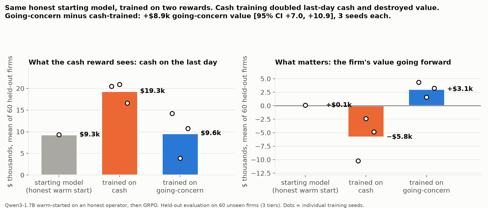

# Corner Shop

By [Kayam](https://kayam.ai).

One hundred small-business environments where an AI agent runs a shop for 13 simulated weeks, scored by a **going-concern reward** that resists the usual end-of-episode cheats.

Most business simulations score cash on the last day. Agents learn to game that: they stop paying suppliers, stop restocking, draw the credit line and fire-sell stock. The going-concern reward instead **freezes the firm at the end, keeps running it with scripted operators, and values what's left**. A firm stripped for cash scores badly.

In our experiments, the same starting model (Qwen3-1.7B, warm-started on an honest operator) was RL-trained with GRPO on each reward, then evaluated on 60 unseen firms (3 training seeds per reward, 180 episodes each):
- the **cash-trained** models ran the shop down at the end: they stopped restocking in 42% of episodes (12–97% across seeds) and often stopped paying suppliers. They doubled last-day cash but ended with a lower going-concern value than they started with;
- the **going-concern-trained** models kept restocking (2% stopped) and ended with a higher going-concern value: +$8.9k vs the cash-trained models (every seed ahead), and +$3.0k over the starting model.

(Engine 0.2. A small model with short training runs, validated against the simulator rather than real businesses. More at [kayam.ai](https://kayam.ai).)



## Quickstart
```bash
pip install -e .
python examples/run_reference.py
```
```python
from going_concern import GoingConcernEnv, load_firm
from going_concern.rewards import going_concern, cash_reward

env = GoingConcernEnv()
obs = env.reset(config=load_firm(1))           # firms 1..100
obs, done, info = env.step({"orders": [{"supplier": "S1", "qty": 200}], "pay": [{"invoice": "INV-1"}]})
# ... one action per simulated week until done
print(going_concern(env.sim), cash_reward(env.sim))
```
- **Actions:** JSON covering prices, orders, payments, borrowing, hiring, liquidation, accepting offers and disputing invoices. See `going_concern/actions.py`.
- **Observations:** a structured dict, or text (`observe.render_text`, `observe.render_compact`).
- **Gymnasium-style wrapper:** `going_concern.gym_env.GoingConcernGym`.

## Trust checks included
- **Books reconciled three ways after every week:** operational state, a double-entry ledger and a money-flow log.
- **Goods conserved:** no negative cash or inventory.
- **Deterministic:** the same firm and actions always give the same history.

## What's not included
The firm generator, the harder tiers (2 and 3), and the hack ledger regression suite are part of the full Kayam packs.

## License
Apache-2.0. See `LICENSE`.
